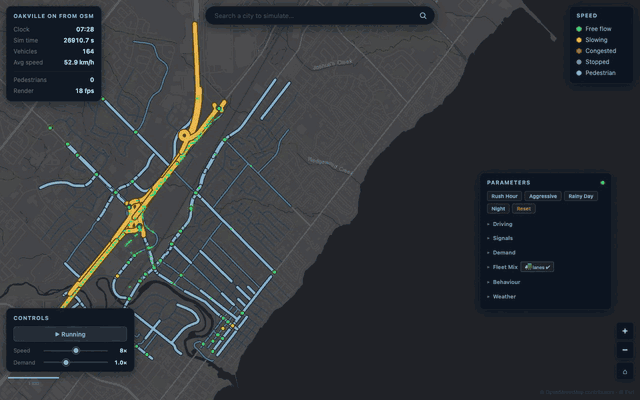

# Traffic Simulation Platform

An OpenStreetMap-based traffic simulation with IDM car following, MOBIL lane changes, signal control, and a live Canvas 2D browser view.



## Features

- City import by name: Nominatim geocoding, Overpass OSM fetch, and a disk cache under `.overpass_cache/`
- Live city hot-swap: import a new location without restarting the server, with progress reported through `/import_status`
- OSM road parsing: ways split at junctions, directed edge segments, `via_nodes` geometry, and GREEN/AMBER/RED quality flags for inferred lanes and speeds
- Network simulation: directed graph, Dijkstra routing by travel time or length, multi-lane edges, queue spillback checks, overlap prevention, and deadlock detection with boundary rerouting
- IDM car following in both scalar and NumPy-vectorised forms, with one batched acceleration call per simulation step
- MOBIL lane changes with politeness, safety, keep-right bias, cooldown, and truck/bus lane discipline
- Signal control from OSM `highway=traffic_signals` nodes, with two-phase plans, yellow and all-red intervals, and per-node offsets
- Social Force Model pedestrian module based on Helbing and Molnar (1995), including vehicle yielding when pedestrian time-to-collision is below 2 s
- Demand generation: Poisson spawn events, legacy residential-to-commercial commute flows, and spatial demand using WorldPop weights, OSM POIs, and building capacity estimates
- Intercity demand: through traffic plus directional entering and leaving flows, with optional surrounding-population weighting
- Temporal demand: 24-hour weekday and weekend profiles, continuous demand for long-running live sessions, and a distance-based walk/bike/car mode split that filters car trips
- Fleet mix: car, van, truck, and bus classes with dimensions, HCM road-type proportions, log-normal driver variation, and class-capped disobedience
- Weather multipliers for clear, rain, heavy rain, and snow, available through scenario data and live parameter controls
- Browser visualisation: Canvas 2D, Esri World Dark Gray Canvas tiles, smooth quadratic-curve roads, vehicle colouring by speed, signal markers, map pan and zoom, and a live stats card
- Live parameter dashboard: IDM, MOBIL, signal, demand, fleet mix, behaviour, and weather sliders, plus Rush Hour, Aggressive, Rainy Day, and Night presets
- Real-time state delivery over WebSocket, with HTTP polling as a fallback
- CLI tools: headless road simulation, roundabout versus signal comparison, OSM bounding-box import, and WorldPop cache listing and deletion
- 34 pytest modules covering the engine, importer, demand models, renderer, editor state, performance, and optional compute backends

## Tech stack

- Python 3.10 or newer
- NumPy for vectorised IDM calculations
- SciPy for optional KD-tree nearest-neighbour lookup
- Python standard library for the HTTP server, WebSocket framing, geocoding, and OSM fetch
- Plain HTML, CSS, and JavaScript with Canvas 2D for the simulation view, with no npm or build step
- Esri World Dark Gray Canvas map tiles (no API key) and OpenStreetMap data
- Leaflet and proj4js from CDNs for the standalone editor
- pytest and pytest-cov for tests and coverage
- Optional: rasterio for WorldPop raster loading, CuPy for CUDA, and JAX for Apple Metal

## Architecture

```text
run.py                  CLI, scenario loader, HTTP/WebSocket server
engine/                 Simulation core
  network.py            Graph, edges, lanes, Dijkstra routing
  network_simulation.py Routing simulation, spawning, IDM, MOBIL, metrics
  simulation.py         Single-road legacy simulation and junction logic
  idm.py, idm_vec.py    Scalar and vectorised IDM
  mobil.py              Lane-change model
  signals.py            Signal phases and plans
  pedestrians.py        Social Force Model
  commute.py            Legacy OD demand
  poi_demand.py         Spatial demand from WorldPop, POIs, and buildings
  worldpop.py           Population weights and cache handling
  buildings.py          Floor and capacity estimation
  demand_profile.py     24-hour demand profiles
  mode_split.py         Walk, bike, and car probabilities
  weather.py            Weather multipliers and Open-Meteo helper
  vehicle_classes.py    Vehicle dimensions and HCM fleet mixes
  config.py             Thread-safe runtime parameters
  metrics.py            Trip records, metrics, and batch confidence intervals
importer/               OSM pipeline
  geocode.py            Nominatim geocoding
  overpass.py           Overpass client and disk cache
  parser.py             OSM JSON parsing and way splitting
  inference.py          Lane and speed inference
  projection.py         WGS-84 and Web Mercator conversion
viz/                    Browser viewer, no build step
editor/                 Standalone map editor and Python editor-state model
scenarios/              Road and network scenario JSON files
tests/                  pytest suite
docs/                   Supporting notes
outputs/                Generated output directory, ignored by git
```

The live server runs a simulation thread and serves the viewer, network JSON, live state, import status, and control endpoints. The browser connects to `/ws` for state pushes and falls back to `/state` polling. Imported networks are built in a background thread and swapped into the running server under a lock.

## Getting started

Create a virtual environment and install the dependencies:

```bash
python3 -m venv .venv
source .venv/bin/activate
python3 -m pip install -r requirements.txt
```

### Live viewer

Start on a blank map:

```bash
python3 run.py --serve
```

Or start with a bundled scenario:

```bash
python3 run.py scenarios/oakville_on.json --serve
```

Open `http://localhost:8765`, then use the search bar to import a city.

Use a different port:

```bash
python3 run.py scenarios/oakville_on.json --serve --port 9000
```

### Headless simulation

The headless CLI supports road-style scenarios such as `highway_single_lane.json` and `highway_multilane.json`:

```bash
python3 run.py scenarios/highway_multilane.json
```

It prints throughput, average speed, density, queue length, average delay, and lane utilisation.

### Compare junction designs

```bash
python3 run.py scenarios/roundabout_vs_signal.json --compare --runs 15
```

### Import an OSM bounding box

The bounding box order is `south,west,north,east`:

```bash
python3 run.py --import-bbox 43.44,-79.72,43.48,-79.63 --output scenarios/custom.json
```

### Manage WorldPop caches

```bash
python3 run.py --worldpop-cache-list
python3 run.py --worldpop-cache-delete oakville
python3 run.py --worldpop-cache-delete-all
```

### Environment variables

There is no `.env.example` and no automatic `.env` loading. The code reads these optional variables from the process environment:

- `WORLDPOP_RASTER_PATH`: path to a WorldPop raster. Without it, origin weights fall back to a uniform distribution.
- `M3_PARALLEL_WORKERS`: number of threads used for spatial demand generation. The default is the lower of 8 and the CPU count.

## HTTP API

- `GET /` serves the viewer.
- `GET /network` returns nodes and edges for the current network.
- `GET /state` returns the current simulation snapshot.
- `GET /ws` upgrades to a WebSocket that receives state after each simulation batch.
- `GET /config` returns the current runtime controls.
- `GET /import_status` returns import progress.
- `GET /vehicle_classes` returns vehicle class specifications.
- `POST /control` updates `paused`, `speed_mult`, `demand_mult`, or a `params` object.
- `POST /import` accepts `{"query": "city name"}` and optionally `{"force": true}`.

## Tests

Run the full suite:

```bash
python3 -m pytest tests/ -q
```

Run with coverage:

```bash
python3 -m pytest tests/ --cov=engine --cov=importer --cov-report=term-missing
```

The suite covers IDM and vectorised IDM, MOBIL, signals, routing, network and single-road simulation, demand profiles, mode split, commute and spatial demand, WorldPop caches, building capacity, weather, vehicle classes, compute backends, metrics, the OSM importer, projection, the renderer, editor export, live demand jams, and performance thresholds.

Some tests depend on the machine or environment: the GPU backend tests require a working CuPy or JAX runtime, and the performance tests check timing thresholds.

## Limitations and roadmap

- City import needs network access to Nominatim and Overpass. Overpass can be slow or rate-limited, so repeated imports rely on the disk cache.
- Imported cities use a fixed bounding box of roughly 5 km around the geocoded centre, not a full metropolitan area.
- Headless `run.py` only supports road scenarios with a `road` block. OSM network scenarios must be run through `--serve`, which builds a `NetworkSimulation`.
- Signal plans are simplified two-phase plans. Offsets are spread across signal nodes rather than optimised for green waves.
- The Social Force Model is available to `NetworkSimulation`, but the CLI and server do not currently build pedestrian agents from scenario files.
- Open-Meteo weather fetching exists in `engine/weather.py` but is not connected to the CLI or server. Weather is applied through scenario data or the dashboard multipliers.
- GPU support is optional and depends on a working CuPy or JAX installation. The NumPy backend is always available.
- WorldPop raster weighting requires rasterio and an external raster file. Without both, demand uses uniform node weights.
- The editor is a standalone browser page and is not served by `run.py`.
- There is no persistence layer, user accounts, or multi-user coordination.

## Data and attribution

- Road data: OpenStreetMap contributors, ODbL licence, https://www.openstreetmap.org/copyright
- Map tiles: Esri World Dark Gray Canvas, https://www.esri.com/
- Geocoding: Nominatim and OpenStreetMap

## References

- Treiber, Hennecke, and Helbing (2000), Congested traffic states in empirical observations and microscopic simulations, Physical Review E 62(2)
- Kesting, Treiber, and Helbing (2007), General lane-changing model MOBIL for car-following models, Transportation Research Record 1999(1)
- Helbing and Molnar (1995), Social force model for pedestrian dynamics, Physical Review E 51(5)
